## 1. Project Description and Diagram

### Overview

The goal of this project is to automate the building and publishing of a container image for a website. When you push a version tag to GitHub, this triggers a GitHub Actions workflow that builds the Docker image and pushes it to a public DockerHub repository. Each release gets its own version tags, so a new release does not overwrite the previous one and it can be rolled back to an earlier version of the site.

**Tools:**

- Git: Tracks the changes in the local clone and creates version tags
- GitHub: Stores the repository, keeps DockerHub credentials as repo secrets, and runs the action workflow
- GitHub Actions: Runs the workflow to complete the DockerHub login, image build, and pushing it with version tags
- Docker: Builds the image and runs containers
- Apache `httpd:2.4`: Base image that serves the site from inside a container
- DockerHub: Public repository that stores the image and its tags

### Diagram

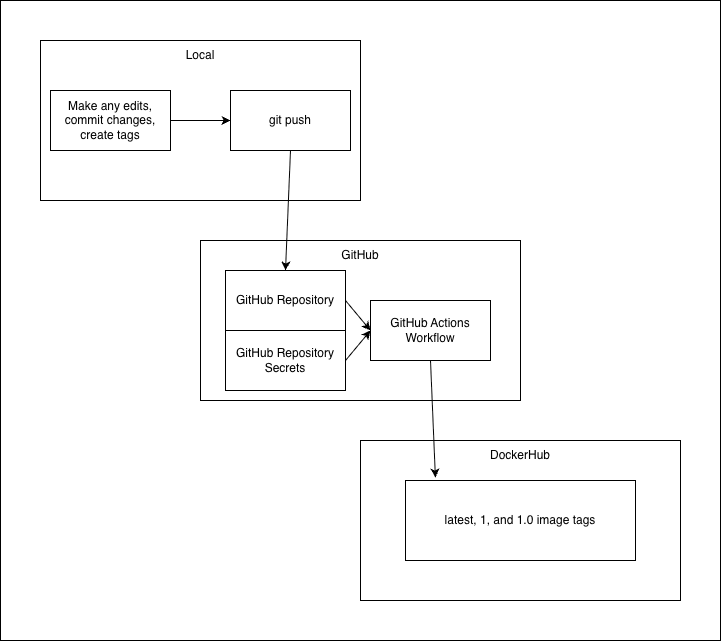

## 2. Building the web service container

### Web Content 

The website content for this project is a set of pages that I built for my CS 2800 course. 

The site has a couple pages of HTML, a CSS styling file, and some JS. 

All of the following files live in [`Website content`](web-content/) foler:

- [index.html](web-content/index.html): the home page
- [`pages/contact.html`](web-content/pages/contact.html): contact page
- [`pages/form.html`](web-content/pages/form.html): a sample form page
- [`pages/indexInClass.html`](web-content/pages/indexInClass.html): a random page with an image
- [`templete.html`](web-content/templete.html): templete that was created to build the other pages
- [`style.css`](web-content/style.css): styling file shared by the pages
- [`script.js`](web-content/script.js): work in progress addition to add some function to the form page
- [`images/`](web-content/images/): images used by the pages

**Note: No generative AI was used for the creation of these pages. These pages were all personally created for my current in class follow along example in my CS 2800 course that I am taking this semester.**


### Dockerfile

The [Dockerfile](Dockerfile) tells docker how to build our iamge. It only has the two following instructions:

- `FROM httpd:2.4` which starts from the official Apache HTTP Server image

- `COPY web-content/ /usr/local/apache2/htdocs/` copies everything in `web-content/` into `/usr/local/apache2/htdocs/`, which is the default directory `httpd` serves web pages from. 

**To build the Dockerfile:**

In the root directory of the repository (the folder that holds the Dockerfile) run `docker build -t ryanmcgill18/ceg3120-ci:latest .`

- `-t` argument allows us to change the name and tag when building
- the image name has to start with my DockerHub username (`ryanmcgill18/`) so it can be pushed to my DockerHub account
- `.` argument tells docker to build on the current file

My actual command to build this docker file was `docker build -t ryanmcgill18/ceg3120-ci:latest .`

**To push the Dockerfile:**

1. First login with `docker login -u ryanmcgill18`

- To login with a PAT (Personal Access Token) rather than a password:
    - Open a browser and go to [DockerHub](https://hub.docker.com)
    - Find the setting for PAT's
    - Generate a new PAT (read/write reccommmended for access scope)
    - Paste that PAT into the command line when prompted for your password on login

2. Then run `docker push ryanmcgill18/ceg3120-ci:latest` in order to push the image to DockerHub

**To run a container from the image:**

Run `docker run -d --name site -p 8080:80 ryanmcgill18/ceg3120-ci:latest` and then open `http://localhost:8080` in a browser.

**[ceg3120-ci](https://hub.docker.com/repository/docker/ryanmcgill18/ceg3120-ci/general) DockerHub Repository**


## 3. GitHub Actions and DockerHub

### Configuring repository secrets

**Creating a PAT for GitHub Actions:**

1. Navigate to [DockerHub](https://hub.docker.com) and under account settings open the Personal Access Token (PAT) setting. 
2. Create a new PAT and give it a descriptive name to show what it is for (mine is GitHub-Secret-CI)
3. Set the permissions scope (read and write is best for this project)
4. Copy the PAT token

**Setting the repository secrets:**

1. In the GitHub repository open Settings, then Secrets and variables, then Actions
2. Click "New repository secret"
3. Enter the name and value of each secret and save it

**Secrets set for this project:**

- `DOCKER_USERNAME`: My DockerHub username (ryanmcgill18)
- `DOCKER_TOKEN`: The PAT created for GitHub Actions

### CI with GitHub Actions

**Trigger:**

The workflow runs when a commit is pushed to the `main` branch, and only `main`. Pushes to any other branch do not start it.

**Steps:**

1. **Checkout** (`actions/checkout`) copies the repository contents onto the runner so the `Dockerfile` and `web-content/` are available
2. **Set up Docker Buildx** (`docker/setup-buildx-action`) sets up the builder, which is needed to build for more than one architechture platform 
3. **Login to DockerHub** (`docker/login-action`) logs in using the two repository secrets
4. **Build and push** (`docker/build-push-action`) builds the image from the `Dockerfile`, for both `linux/amd64` and `linux/arm64`, and pushes it to DockerHub as `latest`

**What needs to be updated if this is used in another repository**

In the workflow file:
- `DOCKER_HUB_REPO` needs to be changed to the new DockerHub repository
- The branch name changes if necessary 
- The platforms line if other platforms are needed

In the repository:
- Secrets for `DOCKER_USERNAME` AND `DOCKER_TOKEN`
- Docker file at repo root

**Workflow file:** [`dockerPushWorkflow.yml`](https://github.com/WSU-kduncan/ceg3120-cicd-mcgill30-f26/blob/8a48670caec853157be2171bbe5ac087508bfb3b/.github/workflows/dockerPushWorkflow.yml)

**To verify the image works when a container is run from it:**

```
docker pull ryanmcgill18/ceg3120-ci:latest
docker run -d --name site -p 8080:80 ryanmcgill18/ceg3120-ci:latest
```

Then open `http://localhost:8080` in a browser.

**[ceg3120-ci](https://hub.docker.com/repository/docker/ryanmcgill18/ceg3120-ci/general) DockerHub Repository**

## 4. Semantic Versioning

### Generating Tags

- To see your tags in the repository: `git tag -l`
- To create a tag in a git repository (latest commit): `git tag -a v1.0.0 -m "Release 1.0.0"`
- To push a tag in a repository to GitHub: `git push origin v1.0.0`

### Semantic Versioning Container Images with GitHub Actions

The workflow triggers a run whenever a tag that matches `v*.*.*` is pushed to the repository.
In part two the workflow was configured to only trigger a run when something was pushed to main, now that is no longer the case
and runs are only triggered with tagging.

**Workflow Steps**

1. Checkout:`actions/checkout` copies the repository contents onto the runner
2. Docker meta: `docker/metadata-action` reads the tag that was pushed and generates the image tags, which are latest, major, and major and minor
3. Set up Docker Buildx: `docker/setup-buildx-action` allows for a multi-platform build
4. Login to DockerHub `docker/login-action` logs in using the repository secrets
5. Build and push: `docker/build-push-action` builds the image  and pushes it with the proper tags generated by step 2

**What needs to be updated if this is used in another repository**

In the workflow file:
- `DOCKER_HUB_REPO` needs to be changed to the new DockerHub repository
- The branch name changes if necessary 
- The platforms line if other platforms are needed

In the repository:
- Secrets for `DOCKER_USERNAME` AND `DOCKER_TOKEN`
- Docker file at repo root

**Workflow file:** [`dockerPushWorkflow.yml`](https://github.com/WSU-kduncan/ceg3120-cicd-mcgill30-f26/blob/5152b9d26315c2188fc28897357d49d4c0116874/.github/workflows/dockerPushWorkflow.yml)

### Testing and validating

**To test that the workflow did its tasking:**

1. Push a tag like `git push origin v1.1.0`
2. Open the Actions tab in the GitHub repository. The newest run should show the tag as its trigger and a green check mark
3. Push a commit without a tag. No workflow run should start if there is no tag on the commit
4. Open the DockerHub repositorys Tags page and confirm the new tags are there

**To verify the image in DockerHub works when a container is run:**

```
docker run -d --name v1-0 -p 8081:80 ryanmcgill18/ceg3120-ci:1.0
docker run -d --name v1-1 -p 8082:80 ryanmcgill18/ceg3120-ci:1.1
```

Then open `http://localhost:8081` and `http://localhost:8082` in a browser. Each one will serve its own site and shows that one release does not overwrite another, and that version history can be rolled back to.

**[ceg3120-ci tags](https://hub.docker.com/r/ryanmcgill18/ceg3120-ci/tags) DockerHub Repository**


## 5. Resources

- [docker/metadata-action (semver)](https://github.com/docker/metadata-action?tab=readme-ov-file#semver) - Used for the `type=semver` patterns that generate the major and major.minor tags.
- [Docker Docs: Manage tags and labels](https://docs.docker.com/build/ci/github-actions/manage-tags-labels/) - Used to set up `docker/metadata-action` section so that the tags and labels are generated from the git tag.
- [Docker Docs: CI with GitHub Actions](https://docs.docker.com/build/ci/github-actions/) - Used as the overall reference for building and pushing docker images from a workflow.
- [build-push-action documentation](https://github.com/marketplace/actions/build-and-push-docker-images) - Used for the build and push step, including `platforms`, `tags` and `labels`.
- [GitHub Docs: Publishing images to Docker Hub](https://docs.github.com/en/actions/tutorials/publish-packages/publish-docker-images#publishing-images-to-docker-hub) - Used for the login step and for storing the DockerHub credentials as repository secrets.
- [git tag documentation](https://git-scm.com/docs/git-tag) - Used to create the version tags (`v1.0.0`, `v1.1.0`) that trigger the workflow.
- [GitHub Actions workflow syntax](https://docs.github.com/en/actions/reference/workflows-and-actions/workflow-syntax) - Used for the `on: push` branch and tag filters, with the `v*.*.*` pattern.

### Latest action versions

- [actions/checkout releases](https://github.com/actions/checkout/releases)
- [docker/setup-buildx-action releases](https://github.com/docker/setup-buildx-action/releases)
- [docker/login-action releases](https://github.com/docker/login-action/releases)
- [docker/build-push-action releases](https://github.com/docker/build-push-action/releases)
- [docker/metadata-action releases](https://github.com/docker/metadata-action/releases)

Used Claude (Anthropic, Sonnet 5.5) to debug the Dockerfile COPY path and the arm64 “no matching manifest” error fixed with a multi-platform build.

## 6. Testing and Proof

**1. Local run:** Shows the container running with a functional site

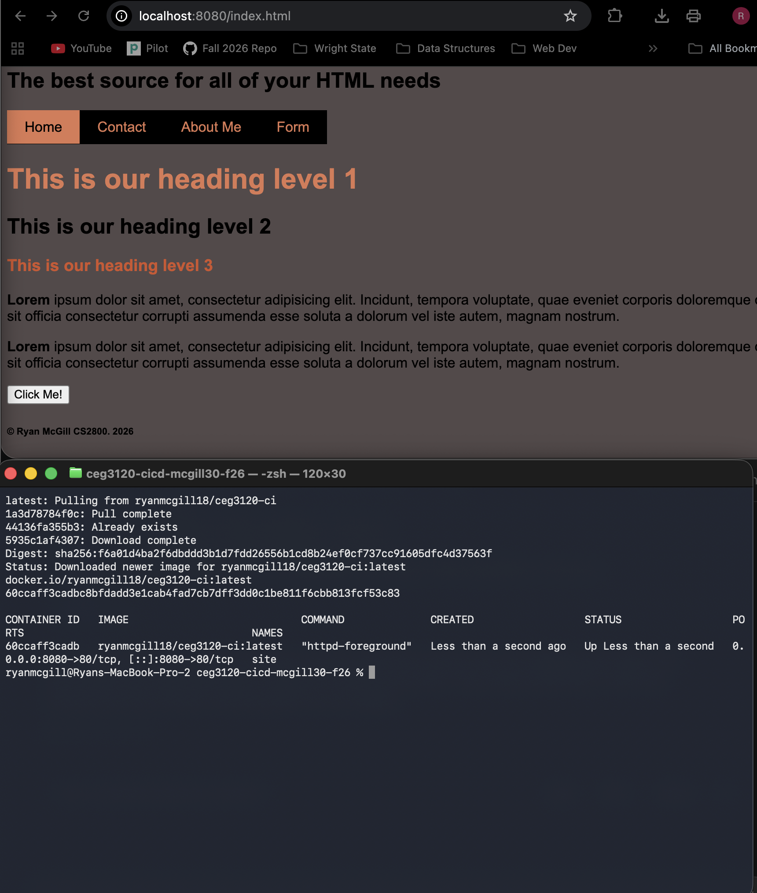

**2. Repository secrets:** Shows public GitHub Repo with a secret for both DOCKER_USERNAME and DOCKER_TOKEN

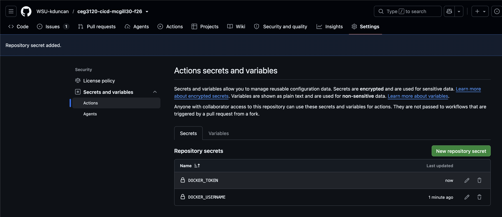

**3. Main trigger:** Proves a successful workflow run

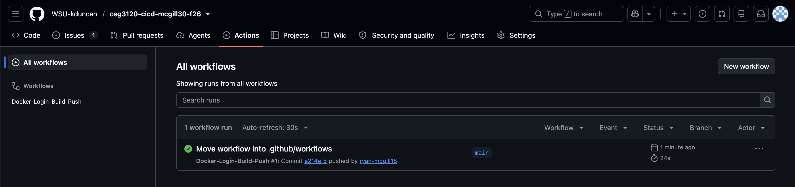

**4. Branch negative test:** Proves that pushing to a test branch does not trigger the workflow run

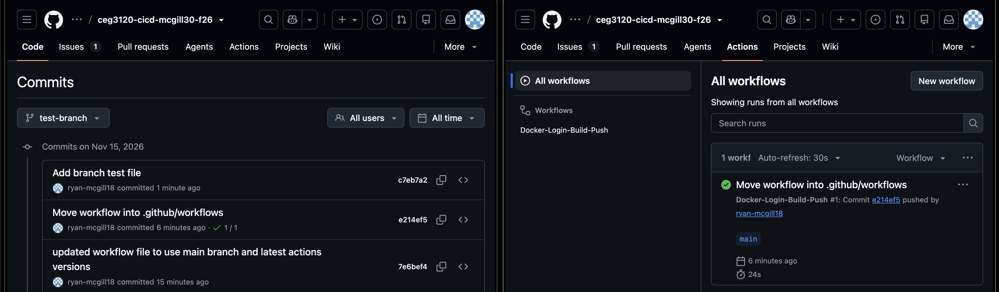

**5. Change to image:** Shows a change made to the site after pushing to main and triggering the workflow

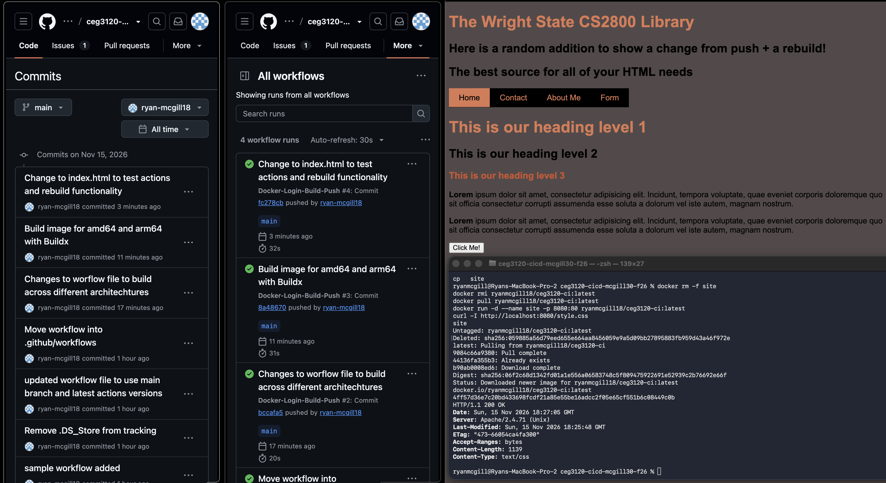

**6. Tag trigger:** Version tag and it's succcessful workflow run

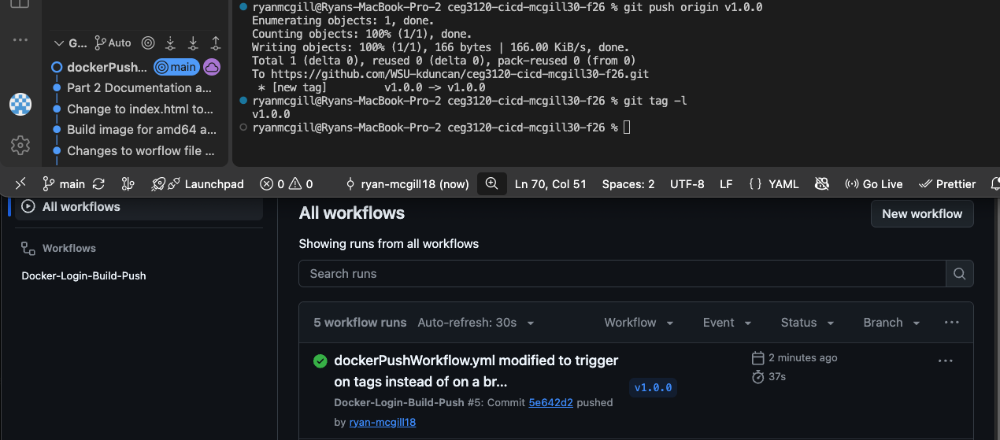

**7. Tag negative test:** Proves that when pushing a commmit without a version tag, no workflow run is triggered

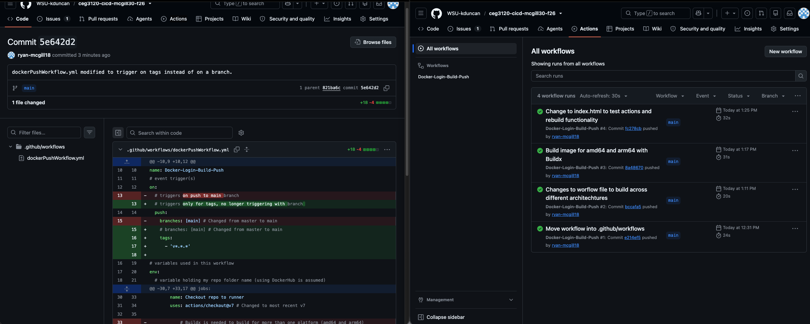

**8. Tag set:** Proves the build process is updating the DockerHub repository tags accordingly

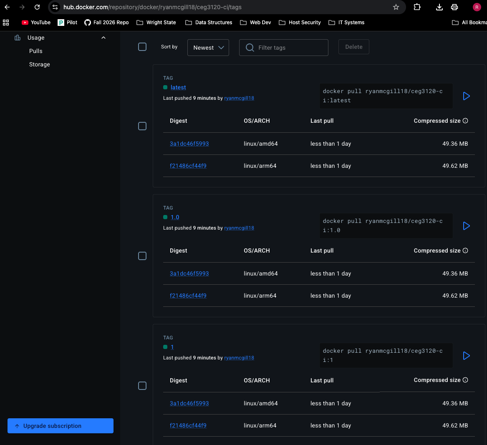

**9. Two releases:** DockerHub repository tags after a second release

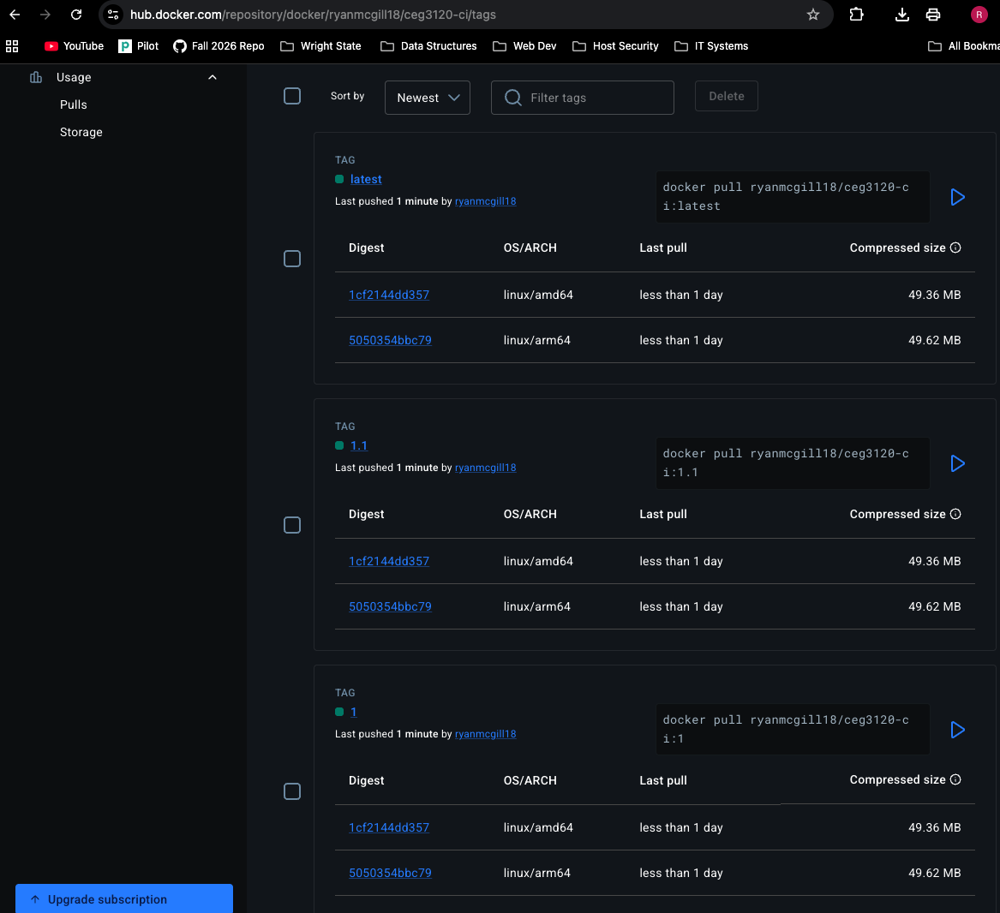

**10. Rollback:** 2 release versions both live side by side, proving rollback is possible

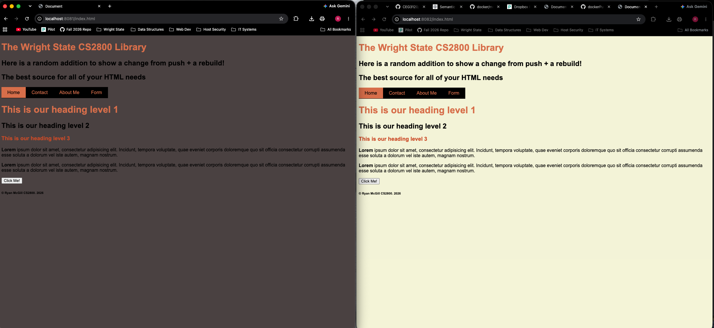


